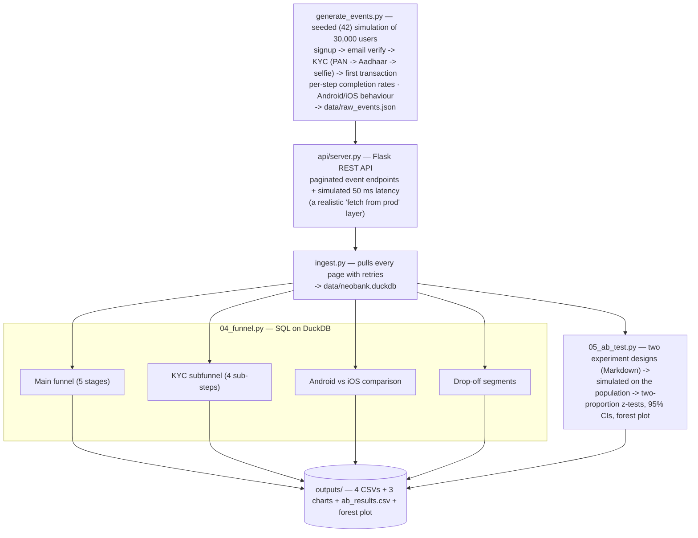

# Neobank Funnel — Onboarding Funnel Analytics + A/B Test Design

Full-funnel analytics for a neobank onboarding flow: **30,000 synthetic users** served through a **Flask REST API**, ingested into **DuckDB**, analysed with SQL (main funnel, KYC subfunnel, device comparison, drop-off segments), and closed out with **two simulated A/B experiments** with two-proportion z-tests.

**Author:** Suparna Deshmukh
**Stack:** Python · Flask · DuckDB (SQL) · NumPy / SciPy · matplotlib

**Live:** none — the Flask layer is a *local* simulation of a prod event API (pagination + latency), and the whole pipeline runs on your machine end to end.

## System design



**Key decisions**

- **API in the middle on purpose** — the analyst never reads the raw file; events are fetched page-by-page with retries through a paginated REST API with simulated latency, so the ingest pattern is what you'd use against a real prod event store.
- **Seeded synthetic data** (realistic step-by-step completion rates) makes every number reproducible end to end; nothing personal is involved.
- **Findings feed the experiments**: the two worst leak points (Aadhaar step, Android selfie) become the two A/B treatments, each with documented hypotheses, primary/secondary metrics and expected effect (`ab_hypotheses.md`).

## Results (from committed `outputs/`)

**Main funnel** (`outputs/main_funnel.csv`) — 28,477 signups:

| Step | Users | % of signups | Drop-off |
|------|------:|-------------:|---------:|
| Signup completed | 28,477 | 100 % | — |
| Email verified | 24,233 | 85.1 % | 14.9 % |
| KYC started | 16,817 | 59.1 % | 30.6 % |
| KYC completed | 8,434 | 29.6 % | 49.8 % |
| First transaction | 7,153 | 25.1 % | 15.2 % |

**KYC subfunnel** (`outputs/kyc_subfunnel.csv`): PAN 92.8 % → Aadhaar 75.8 % → selfie 79.6 % → completed 89.5 % — the **Aadhaar step is the single biggest sub-funnel leak**.

**A/B results** (`outputs/ab_results.csv`), both significant:

| Experiment | Population | Control | Treatment | Lift | z |
|------------|-----------|--------:|----------:|-----:|---:|
| 1 — Real-time field validation | All KYC starters (n≈16.8K) | 50.43 % | 58.91 % | **+8.47 pp** | 11.04 ✅ |
| 2 — Android selfie progress bar | Android KYC starters (n≈8.5K) | 49.96 % | 60.59 % | **+10.63 pp** | 9.84 ✅ |

## How to run

```bash
pip install flask duckdb requests pandas numpy scipy matplotlib

python generate_events.py   # regenerate events (seed 42) — safe to skip
python api/server.py        # start the event API
python ingest.py            # pull pages -> neobank.duckdb
python 04_funnel.py         # funnel SQL -> outputs/
python 05_ab_test.py        # A/B designs + simulation + z-tests -> outputs/
```

## Repository layout

```
generate_events.py      seeded 30K-user event simulator
api/server.py           Flask REST API (pagination + latency)
ingest.py               retry-based page puller -> DuckDB
04_funnel.py            funnel / subfunnel / device / segment SQL
05_ab_test.py           experiment designs + simulation + z-tests
data/                   raw_events.json + neobank.duckdb
outputs/                CSVs, charts, ab_results.csv, ab_hypotheses.md
neobank_funnel_report-2.pdf   full report · ab_hypotheses.md — hypotheses doc
```
